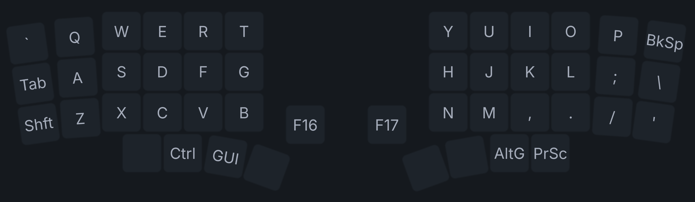

# miiUnic Roque

  

Firmware and configuration for the **miiUnic Roque**, a custom split wireless keyboard built around the nice!nano v2 / nRF52840 controller.

## Firmware builds

GitHub Actions builds the left and right firmware for these configurations:

| Artifact | Display configuration |
| --- | --- |
| `Roque-left` | Infely `nice-view-battery` for the small nice!view display |
| `Roque-right` | Infely `nice-view-battery` for the small nice!view display |
| `Gran-Roque-left` | Original Gran Roque large-display shield and custom widgets, preserved from the original project |
| `Gran-Roque-right` | Original Gran Roque large-display shield and custom widgets, preserved from the original project |
| `settings-reset` | ZMK settings reset utility; not normal keyboard firmware |

The Infely display is selected **only for the `Roque` targets**. The `Gran Roque` targets continue to use the original `granroque` shield, display overlay, widgets, Kconfig, and VCOM driver dependency. The two display implementations are intentionally kept separate.

## Build and flash

1. Push the repository to GitHub or open the **Actions** tab and run **Build ZMK firmware**.
2. Wait for the desired left and right targets to finish successfully.
3. Download the matching `.uf2` artifacts from the same successful run.
4. Put the left controller into bootloader mode and flash the left firmware. Repeat with the right controller and its matching firmware.
5. Use `settings-reset` only when you intentionally need to erase ZMK settings.

This repository contains source configuration, not precompiled UF2 files. GitHub Actions must complete successfully to produce firmware artifacts.

## Roque hardware configuration

The display migration changes the selected display shield for the small-screen Roque target only. The original matrix, keymap, encoder pins, backlight PWM, battery node, and custom `nice_view_spi` bus remain unchanged. See [the pin audit](doc/pin-audit.md) for details.

## Key files

- `build.yaml` — active firmware targets.
- `config/west.yml` — ZMK modules; original Gran Roque display dependencies are retained, and Infely is added for Roque.
- `config/roque-nice_view.conf` — original Roque-specific display/build options.
- `boards/shields/roque/` — Roque matrix, wiring overlays, and keymap.
- `boards/shields/granroque/` — original large-display implementation, left unchanged.

## Keymap

